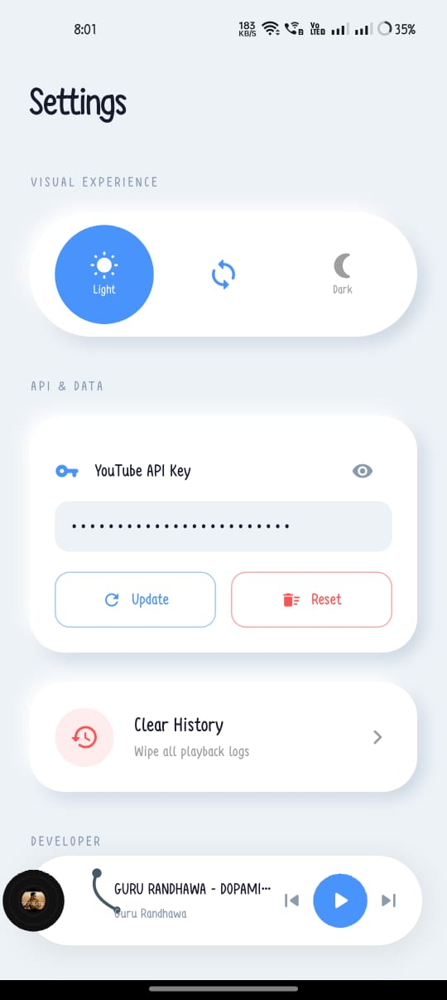
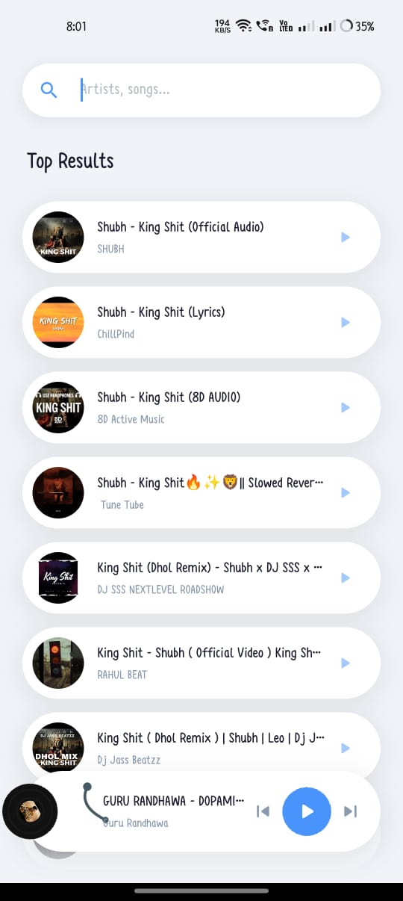
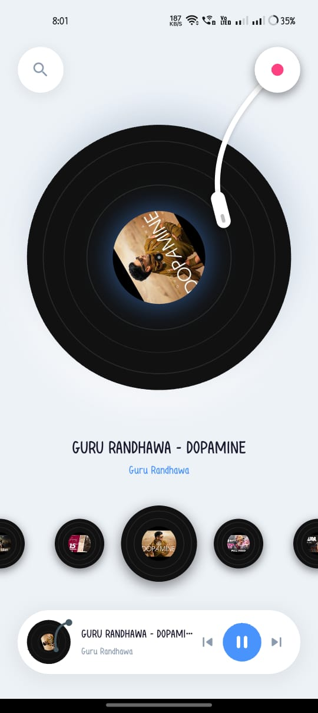
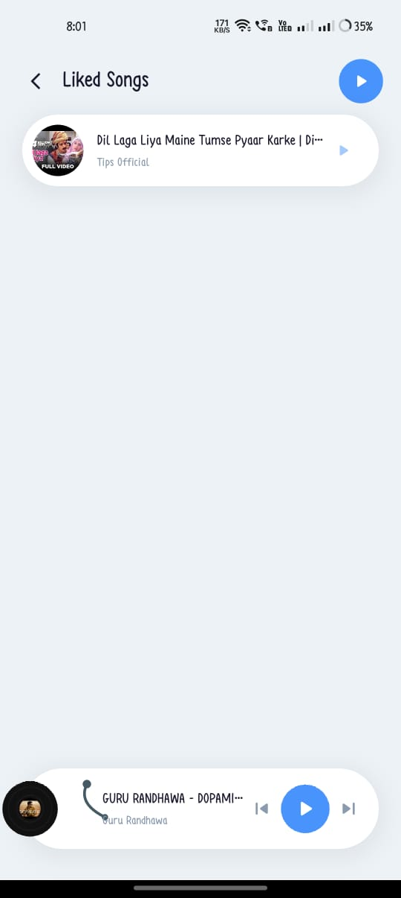
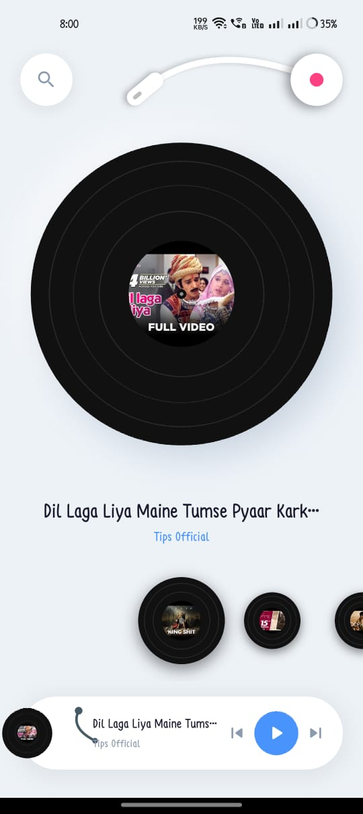

# Noor Music Player

 <b>A Premium Neumorphic Music Experience built with Flutter</b> 
 
 🎵 Gramophone UI • ⚡ Smooth Performance • 🫧 Soft UI • 🌍 YouTube Streaming 

## 📸 Screenshots

  
  
  

  
  

✨ Features
🎙️ Interactive Gramophone UI
Realistic vinyl rotation with dynamic needle interaction based on playback
🫧 Neumorphic Design System
Clean soft UI with light & dark mode support
🎯 Haptic Feedback
Feel every interaction — skip, play, like
🔄 Sync-Glow Animation
Record label glows with playback state
🌍 YouTube Audio Streaming
High-quality streaming via youtube_explode_dart
🛠️ Scalable Architecture
Powered by Riverpod 2.0
🛠️ Tech Stack
Category	Technology
Framework	Flutter 3.x
State Management	Riverpod
Audio Engine	just_audio, audio_service
API & Networking	http, youtube_explode_dart
UI/UX	Neumorphism, Custom Animations
Local Storage	shared_preferences
📥 Download (Android)
Newest build: https://github.com/krishanmurariji/Nebula/releases/download/dev-latest/nebula.apk
Built automatically by GitHub Actions on every push. See docs/RELEASING.md for the one-time signing setup.

🚀 Getting Started
📌 Prerequisites
Flutter SDK (latest stable)
⚙️ Installation
# Clone the repository
git clone https://github.com/krishanmurariji/nebula_music_player.git

# Go to project directory
cd nebula_music_player

# Install dependencies
flutter pub get
🔑 No API key needed
Search and playback both work without a YouTube API key or quota.

▶️ Run App
flutter run
📂 Project Structure
lib/
│── models/        # Song
│── providers/     # Riverpod state (player, library, search, theme)
│── screens/       # Home, Search, Library, Player, Settings, Playback Log
│── widgets/       # Reusable UI components
│── services/      # Audio engine
│   ├── audio_handler.dart        # Playback controller (audio_service)
│   ├── latest_wins_runner.dart   # One load at a time, newest request wins
│   ├── stream_resolver.dart      # De-duplicated, circuit-broken stream lookup
│   ├── fallback_sources.dart     # Piped/Invidious backup when YouTube fails
│   ├── progressive_download.dart # One download feeds player + cache
│   ├── audio_cache.dart          # Async LRU disk cache
│   └── youtube_search_service.dart
test/              # Unit tests for the services above
🚧 Roadmap
 🎵 Offline Playback
 ❤️ Playlist & Favorites
 🔍 Smart Recommendations
 🎚️ Equalizer Support
🤝 Contributing

Contributions are welcome!

# Fork the repo
# Create your branch
git checkout -b feature/YourFeature

# Commit changes
git commit -m "Add YourFeature"

# Push
git push origin feature/YourFeature

Then open a Pull Request 🚀

📄 License

MIT License

👨‍💻 Author

Krishan Murari
Flutter Developer • UI/UX Enthusiast • Marvel Fan 🚀

⭐ Support

If you like this project:

👉 Give it a star on GitHub
👉 Share it with others
