<div align="center">


<p>
  <a href="https://github.com/krishanmurariji/Noor/actions/workflows/ci.yml"></a>
  <a href="https://github.com/krishanmurariji/Noor/actions/workflows/android-release.yml"></a>
  
  
  
</p>

<p>
  <a href="#-a-look-around">A look around</a> ·
  <a href="#-made-to-be-swiped">Gestures</a> ·
  <a href="#-how-it-works">How it works</a> ·
  <a href="#-download">Download</a> ·
  <a href="#-run-from-source">Run from source</a> ·
  <a href="#-testing">Testing</a> ·
  <a href="#-release-pipeline">Releases</a> ·
  <a href="#-troubleshooting">Troubleshooting</a>
</p>

</div>

<br>

> [!NOTE]
> **Noor** is a Flutter music player for Android that streams from YouTube without an account or an API key, keeps every song it plays for offline listening, and is driven almost entirely by swipes. The look is two colours, white and copper, with a turntable at its heart.


## 📱 A look around

<table>
  <tr>
    <td align="center" width="33%">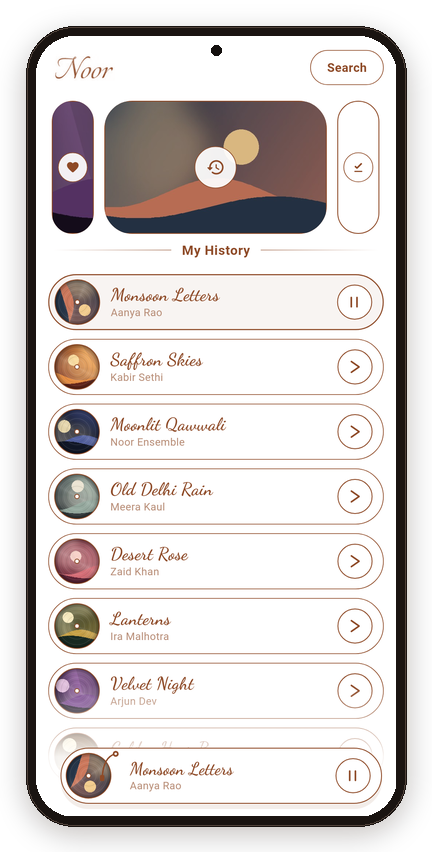<br><b>Home</b><br><sub>My Favorites, My History, My Music and your playlists in one slider; the open list below</sub></td>
    <td align="center" width="33%">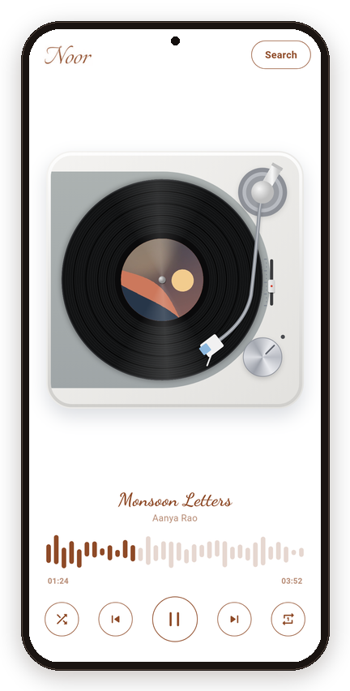<br><b>Player</b><br><sub>A turntable whose record label is the song's artwork, and a bar timeline you can drag</sub></td>
    <td align="center" width="33%">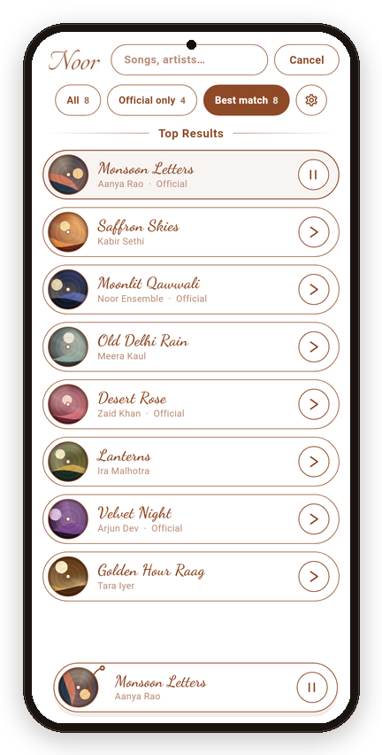<br><b>Search</b><br><sub>All, Official only or Best match; official uploads are marked</sub></td>
  </tr>
  <tr>
    <td align="center">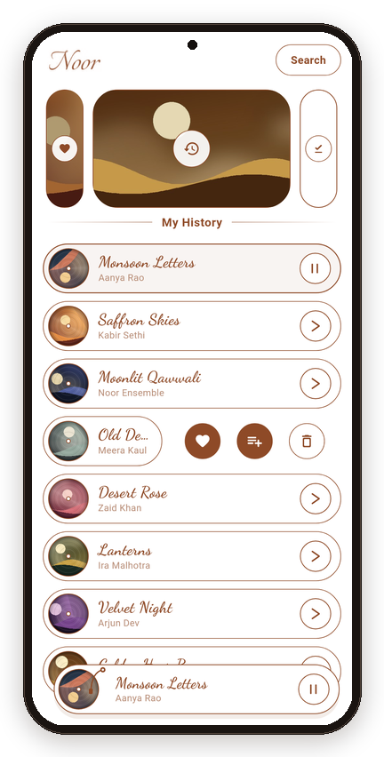<br><b>Song actions</b><br><sub>Swipe a card left: like, add to a playlist, remove from history</sub></td>
    <td align="center">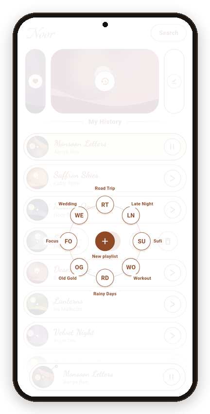<br><b>Playlists in a circle</b><br><sub>Up to 10 playlists fan out; tap one, or make a new one in place</sub></td>
    <td align="center">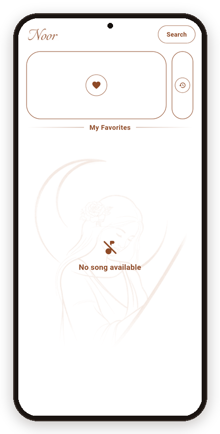<br><b>First run</b><br><sub>Calm and empty until your first song</sub></td>
  </tr>
</table>


## ✨ In motion

<table>
  <tr>
    <td align="center" width="33%">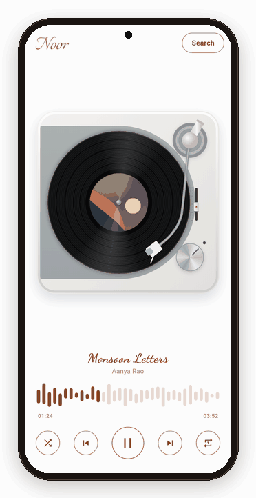<br><b>Swipe the record</b><br><sub>The arm lifts, the record slides away, the next one slides in and the arm comes down once it plays</sub></td>
    <td align="center" width="33%">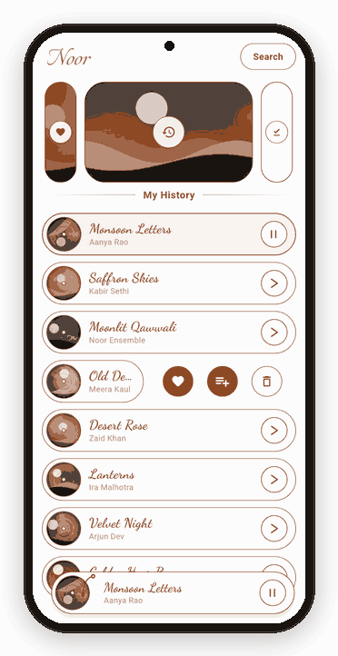<br><b>Fan out the playlists</b><br><sub>Each bubble swings out of the button 60 ms after the last</sub></td>
    <td align="center" width="33%">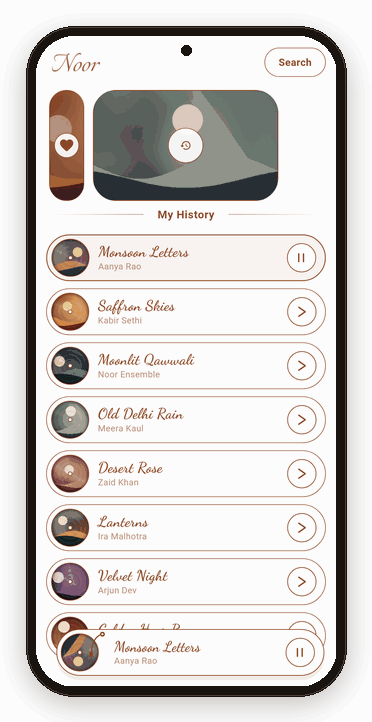<br><b>Change list</b><br><sub>The new list opens with a ring wipe from the centre</sub></td>
  </tr>
</table>


## 👆 Made to be swiped

| Where | Gesture | What happens |
| --- | --- | --- |
| Any song card | Tap | Play (or pause the song that is playing) |
| Search result | Tap the card | It grows to show the full thumbnail and title, channel, views, likes, date, and singer / lyrics / music when the upload names them; tap again to fold. The play button plays |
| Any song card | Double tap | Like or unlike, with a heart that turns red (or white) |
| Any song card | Swipe left, or long press | Show **Like**, **Add to playlist** and **Delete** beside the card |
| Home slider | Swipe or tap a side card | Open that list |
| Home | Swipe down (or pull the list down) | Home sinks away and search drops in |
| Search box | Type | Your recent searches (clock) and YouTube's suggestions drop down; tap one to search it, tap ↖ to put it in the box and keep typing, swipe a recent one away to forget it |
| Home, a playlist card | Long press | Delete the playlist (its songs stay in Favorites and History) |
| Bottom player | Swipe left / right | Next / previous song: the next card slides in beside it; let go early or drag back to cancel |
| Player record | Swipe left / right | Next / previous song: the next record slides in under your finger; let go early or drag back to cancel |
| Player | Swipe down | The song's details drop from the top |
| Player | Swipe up | Up next rises from the bottom |
| Anywhere | Back | Closes one layer at a time (menu, actions, search) |

**Which song comes next?** The list the song belongs to: its playlist first (a song lives in one playlist), then My Favorites, then My History. With nothing else to play, the same song plays again.


## 🧠 How it works

The interface reads and changes state through **Riverpod** providers. One **audio handler** (built on `audio_service` and `just_audio`) owns playback, so the notification, lock screen and headphone buttons always agree with the app.

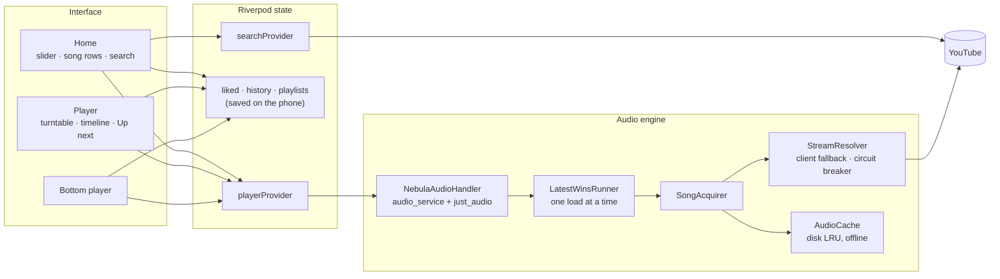

<details>
<summary><b>What happens when you tap a song</b></summary>

<br>

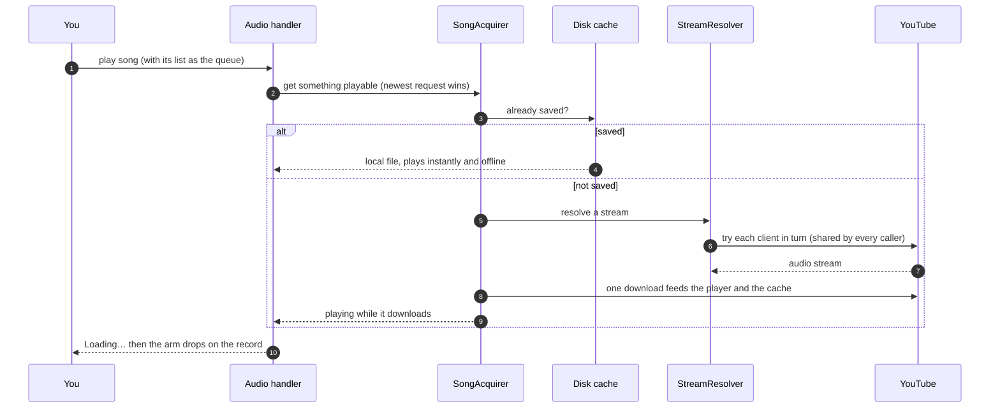

Rapid skipping is safe: `LatestWinsRunner` keeps only the newest request, and every step can be abandoned the moment you move on, so no download is left running.

</details>

### Built to keep playing

- **Client fallback.** YouTube refuses some app clients from time to time; the resolver tries each one in turn and backs off from a client that is rate limited (`youtube_clients.dart` is the file to refresh when YouTube changes).
- **One download, two uses.** `ProgressiveDownload` feeds the player and the disk cache from a single request.
- **Offline first.** Every song played is kept in an LRU disk cache (written to a temporary name and renamed, so a crash never leaves half a song), so History, Favorites and playlists play without internet. **My Music** is the phone's own music files (read from Android's media library with your permission), not the songs Noor saved.
- **Honest failures.** Errors are sorted into "ignore", "retry" and "skip"; a song that cannot play never leaves a dead end, and the bottom player says what is happening.
- **Diagnosable on the phone.** Settings has a **Playback Log** (with tokens removed) and optional **Backup Sources** (your own Piped or Invidious servers).

### Tech stack

| Layer | Technology |
| --- | --- |
| App | Flutter 3.47, Dart 3, Material 3 |
| State | `flutter_riverpod` 2 (`StateNotifier` providers) |
| Playback | `just_audio`, `audio_service` (notification and lock-screen controls) |
| YouTube | `youtube_explode_dart` with refreshed clients, keyless search with its own ranking |
| Storage | `shared_preferences` (library), on-disk audio cache, `cached_network_image` (artwork) |
| Look | Custom painters (turntable, record, timeline), Dancing Script and Cormorant Garamond |
| Delivery | GitHub Actions: tests, then a signed release APK |


## 📁 Repository map

```text
Noor/
├─ lib/
│  ├─ screens/      home (slider, lists, search), player, up next, mini player, settings, playback log
│  ├─ widgets/      song_row (swipe actions, playlist circle), search filter bar
│  ├─ theme/        palette, song card, turntable, record, play/pause morph, artwork, watermark
│  ├─ providers/    player, library (liked, history, playlists), search, queue rules, last played
│  ├─ services/     audio handler, song acquirer, stream resolver, YouTube clients, cache, search
│  └─ models/       Song
├─ test/            unit and widget tests (services, gestures, screens)
├─ tool/readme/     makes the README art, screenshots and GIFs from the real widgets
├─ docs/            releasing guide, acceptance checklist, README graphics
└─ android/         launcher icons, the girl on the launch screen
```


## 📥 Download

The newest build of the app, made by GitHub Actions:

**[⬇ noor.apk (newest build)](https://github.com/krishanmurariji/Noor/releases/latest/download/noor.apk)**

Open the link on the phone and install. If Android says the signature does not match, uninstall the old Noor first (see [Troubleshooting](#-troubleshooting)). To be offered every new build automatically, add this repository to [Obtainium](https://github.com/ImranR98/Obtainium).


## 🚀 Run from source

```bash
git clone https://github.com/krishanmurariji/Noor.git
cd Noor
flutter pub get
flutter run
```

Use **Flutter 3.47.x** (`flutter --version`). Flutter 3.50 and newer need Gradle 9.3+, which this project does not use yet. No API key and no account are needed for search or playback.

| Command | What it does |
| --- | --- |
| `flutter analyze --no-fatal-infos` | Lints, as CI runs them (warnings fail, infos do not) |
| `flutter test` | The whole test suite |
| `flutter build apk --release` | A release APK (signed with your key when `android/key.properties` exists) |

<details>
<summary><b>Regenerate the README graphics</b></summary>

<br>

Every screenshot and GIF here is rendered from the real widgets, with fictional songs and abstract cover art:

```bash
python3 tool/readme/make_art.py                              # cover art
flutter test tool/readme/screens_test.dart --update-goldens  # frames into build/readme
python3 tool/readme/compose.py                               # phone frames, GIFs and SVGs
```

</details>


## 🧪 Testing

Each change runs through the analyzer and the full test suite in CI before an APK is built.

| Area | Tests | What they check |
| --- | --- | --- |
| Playback engine | `song_acquirer`, `stream_resolver`, `latest_wins_runner`, `progressive_download`, `http_range_download`, `stream_failure_handling`, `playback_failure` | Client fallback, circuit breaking, abandoning work on skip, one download for player and cache, error handling |
| Storage | `audio_cache`, `robustness_data` | Atomic writes, eviction that never touches the playing song, damaged saved data |
| YouTube | `youtube_clients`, `youtube_search_service`, `search_ranking`, `robustness_search`, `song_details`, `webview_js_solver` | Clients, keyless search, official uploads first, newest search wins |
| Network | `fallback_sources`, `connectivity_and_log`, `network_diagnostics`, `self_test` | Backup servers, offline detection, log redaction |
| Interface | `song_row`, `noor_song_card`, `player_screen`, `home_empty_state`, `search_filter`, `queue_rules`, `responsive` | Swipe actions, the playlist circle, the keyboard, back handling, empty states, next-song rules |
| Safety | `security` | Cache ids cannot escape their folder, hostile servers and oversized downloads are refused, secrets never reach the log |

```bash
flutter test                      # everything
flutter test test/song_row_test.dart   # one file
```


## 📦 Release pipeline

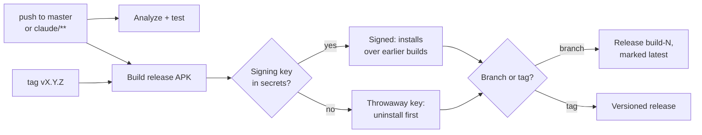

- Every push to `master` or a `claude/**` branch publishes a release `build-<number>` and marks it **latest**, so `releases/latest/download/noor.apk` always gives the newest APK. This works with GitHub's *immutable releases* setting on, because no release tag is ever reused.
- A tag such as `v1.2.0` publishes a permanent release, and refuses to publish without the signing key.
- One-time signing setup, step by step: [`docs/RELEASING.md`](docs/RELEASING.md).


## 🩺 Troubleshooting

<details>
<summary><b>"App not installed" or a signature mismatch</b></summary>

<br>

The new APK was signed with a different key than the one on the phone. Uninstall Noor, then install again. Adding the signing secrets once (see [`docs/RELEASING.md`](docs/RELEASING.md)) makes every later build install as an update.

</details>

<details>
<summary><b>A song will not play</b></summary>

<br>

The bottom player shows what is happening ("Loading…", "Retry in 20 s…"). If YouTube is limiting your network, wait a few minutes. **Settings → Playback Log** shows each step, and **Settings → Backup Sources** lets you add your own Piped or Invidious server.

</details>

<details>
<summary><b>No controls in the notification or on the lock screen</b></summary>

<br>

Android 13 and newer hide media controls until notifications are allowed. Noor asks once; if you said no, allow notifications for Noor in Android's settings.

</details>

<details>
<summary><b>The build fails with "Gradle version … is lower than Flutter's minimum"</b></summary>

<br>

You are on Flutter 3.50 or newer. Use 3.47.x for now (CI pins 3.47.9).

</details>


<div align="center">

<sub>Songs and cover art in these screenshots are fictional. Noor streams from YouTube; YouTube is a trademark of Google LLC. Made with Flutter by <a href="https://github.com/krishanmurariji">Krishan Murari</a>.</sub>

</div>
